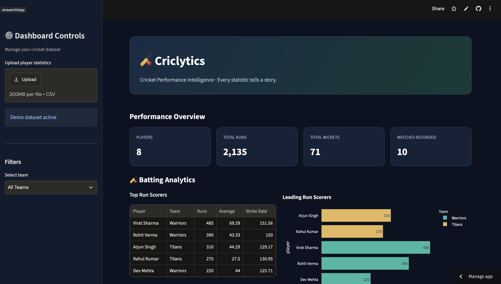
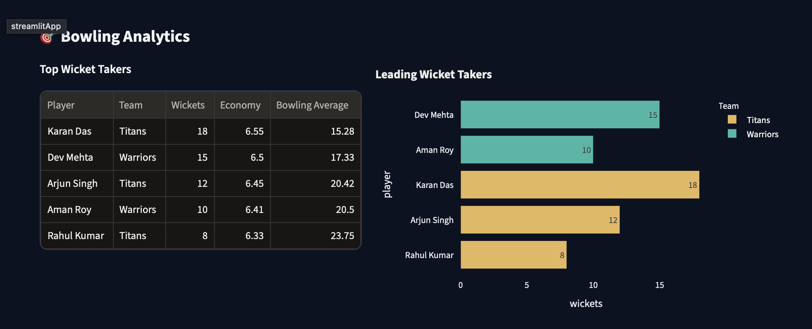
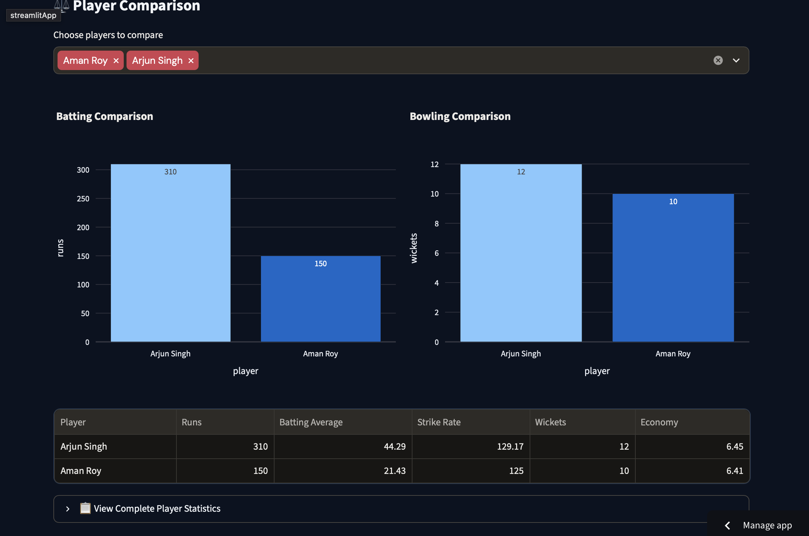

# 🏏 Criclytics
### Every Metric Has a Story.

An interactive cricket performance analytics dashboard built using Python, Pandas, Streamlit and Plotly.

Criclytics transforms player statistics into meaningful performance insights through batting analytics, bowling analytics, player rankings and player comparisons.

<p align="center">
  <a href="https://criclytics.streamlit.app">
    
  </a>
</p>

## 🚀 Live Demo

**[Launch Criclytics](https://criclytics.streamlit.app/)**

## 📸 Application Preview

### Dashboard


### Bowling Analytics


### Player Comparison


## ✨ Features

- Interactive cricket performance dashboard.
- CSV upload for custom player statistics.
- Batting average and strike rate calculations.
- Boundary percentage analysis.
- Bowling economy and bowling average.
- Top batter and bowler leaderboards.
- Team-based filtering.
- Player performance comparison.
- Interactive Plotly visualisations.
- Downloadable player analytics report.
- Input validation and error handling.
- Automated testing with Pytest.

## 🛠️ Technology Stack

| Technology | Purpose |
|---|---|
| Python | Application logic |
| Pandas | Data processing and analytics |
| Streamlit | Interactive web application |
| Plotly | Interactive visualisations |
| Pytest | Automated testing |
| Git & GitHub | Version control |
| Streamlit Community Cloud | Deployment |

## 📁 Project Structure

```text
Criclytics/
│
├── app.py
├── analytics.py
├── requirements.txt
├── README.md
├── .gitignore
│
├── data/
│   └── cricket_stats.csv
│
├── tests/
│   └── test_analytics.py
│
└── screenshots/
    ├── dashboard.png
    ├── bowling.png
    └── comparison.png
```

## ⚙️ Run Locally

### 1. Clone the repository

```bash
git clone https://github.com/srijan-nanda/criclytics.git
cd criclytics
```

### 2. Create a virtual environment

```bash
python3 -m venv venv
source venv/bin/activate
```

### 3. Install dependencies

```bash
pip install -r requirements.txt
```

### 4. Launch the dashboard

```bash
streamlit run app.py
```

Open `http://localhost:8501` in your browser.

## 🧪 Run Automated Tests

```bash
python -m pytest tests/ -v
```

The automated test suite covers metric calculations, player rankings, comparisons, CSV validation and invalid input handling.

## 📊 Analytics Methodology

Criclytics currently calculates:

**Batting**
- Batting Average = Runs / Dismissals
- Strike Rate = (Runs / Balls Faced) × 100
- Boundary Percentage = (Boundary Runs / Total Runs) × 100

**Bowling**
- Economy Rate = Runs Conceded / Overs Bowled
- Bowling Average = Runs Conceded / Wickets
- Bowling Strike Rate = Balls Bowled / Wickets

Bowling deliveries are represented as legal balls bowled rather than decimal overs.

## 🔮 Future Improvements

- Ball-by-ball match analysis.
- Match situation analytics.
- Historical performance tracking.
- Advanced player performance comparisons.
- Cricket data API integration.
- Predictive performance analytics.

## ⚠️ Dataset Disclaimer

The included demonstration dataset contains fictional player records created for educational and analytical demonstration.

The current version uses aggregated player statistics rather than a complete ball-by-ball match dataset.

## 👨‍💻 Developer

Developed as an independent Python data analytics and SportsTech portfolio project.

**Live Application:** https://criclytics.streamlit.app/

**GitHub Repository:** https://github.com/srijan-nanda/criclytics
